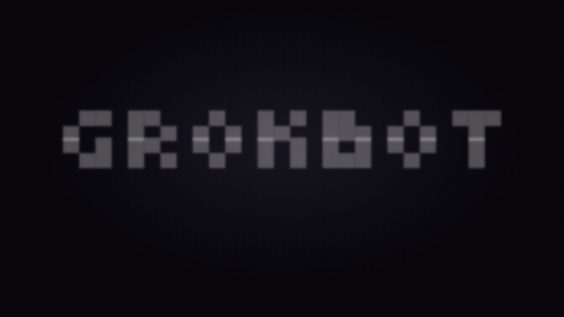

# grokbot



**Grok in your terminal, and Grok inside Claude Code.**

`grokbot` is two things in one npm package:

1. **A terminal coding agent powered by xAI Grok**, built on [pi](https://github.com/earendil-works/pi)'s polished TUI
   (sessions, branching, `/model`, themes, skills, extensions, MCP client), with Grok-native tools added:
   live **X search**, **web search**, **image** and **video** generation.
2. **An MCP server** (`grokbot mcp`) so Claude Code, Cursor, Codex or any MCP host can use Grok:
   ask it, search X/web through it, generate media, or delegate a whole task to the grokbot agent.

Works on **Linux, macOS and Windows** (Node.js ≥ 22.19).

```
                ┌─ grokbot (TUI) ── you
pi + grok ext ──┤
                └─ grokbot mcp ──── Claude Code ─ grok_ask · grok_search_x · grok_search_web
                                                  grok_generate_image · grok_generate_video
                                                  grok_agent ─▶ grokbot --mode json (files, shell, its own MCPs)
```

## Install

```bash
npm install -g grokbot-cli-mcp
grokbot
```

Sign in once:

```bash
grokbot login            # pick: Cursor, xAI account, or xAI API key
grokbot login --cursor   # Grok through your Cursor account (needs the Cursor CLI, `cursor-agent`)
grokbot login --xai      # opens x.ai in your browser: sign in with Google, X or email, confirm the code
grokbot login --api-key  # or paste an API key from console.x.ai
grokbot logout
```

The same works inside the TUI with `/login` (Cursor first, then xAI), or set `XAI_API_KEY` (`GROK_API_KEY` works too).
xAI browser sign-in uses your SuperGrok / X Premium subscription; the CLI and `grokbot mcp` share the login.

**Cursor sign-in** runs Grok 4.7 through the [Cursor CLI](https://cursor.com/cli) (`cursor-agent`), picked
automatically when it is your only login (or `/model` → "Grok 4.7 … (Cursor)"). Grok then reads, edits and runs commands
with Cursor's own tools in your workspace, shown as `⚙ edit file.py` lines, and calls grokbot's tools through a
prompt protocol. `web_search`, `x_search`, image/video generation and the MCP server still need xAI credentials. Each
turn is one `cursor-agent` run, so it is slower than the xAI API and uses your Cursor plan under Cursor's terms. grokbot
passes `--trust` to `cursor-agent` for the folder you start it in. Cursor's tools can't be limited, so `grok_agent`
`read_only` runs refuse Cursor models and need xAI.

Grok (`grok-4.7`) is the default model. Switch anytime with `/model` (any pi provider works).

## The CLI


```bash
grokbot                                   # interactive TUI
grokbot "fix the failing test"            # TUI with an opening prompt
grokbot -p "summarize this repo"          # print mode: answer to stdout, then exit
git diff | grokbot -p "review this"       # pipe input
grokbot --mode json "..." > events.jsonl  # JSONL event stream
grokbot -c                                # continue the last session
```

Inside the TUI, just ask: _"what is X saying about the Bun 2 release?"_, _"generate a logo for this project
into assets/logo.png"_. The extra tools: `web_search`, `x_search`, `generate_image`, `generate_video`. Everything
else is pi: see `/` for commands, and [pi's docs](https://github.com/earendil-works/pi/tree/main/packages/coding-agent/docs)
for skills, extensions, themes and keybindings.

Config lives in `~/.grokbot/agent/` (separate from a stock pi install). Project-level `.pi/` folders and
`~/.agents/skills` are picked up as in pi.

## Use it from Claude Code

```bash
claude mcp add --scope user grokbot -- grokbot mcp
```

On native Windows: `claude mcp add --scope user grokbot -- cmd /c grokbot mcp`.

Then ask Claude things like _"use grok to search X for reactions to the new React compiler"_ or
_"have the grok agent audit src/auth and report back"_.

| Tool | What it does |
|---|---|
| `grok_ask` | One-shot prompt to a Grok model; pass `images` (paths/URLs) for vision. Second opinions, brainstorming. |
| `grok_search_web` | Live web search with cited sources. `allowed_domains`, `excluded_domains`. |
| `grok_search_x` | Real-time X (Twitter) search. `handles`, `excluded_handles`, `from_date`, `to_date`. |
| `grok_generate_image` | Text-to-image or image edit (`source`). Saved locally, returns paths. |
| `grok_generate_video` | Text-to-video or image-to-video. Saved locally, returns the path. |
| `grok_agent` | Runs the full grokbot agent in `directory`. Returns its answer, tool trail, cost and a `session_id` you can pass back to continue. Sends MCP progress per tool call. `read_only: true` limits it to read/search tools (no shell, no edits, no MCP servers). |
| `grok_models` | Lists Grok model ids, context sizes and prices. |

The MCP server uses the same credentials as the CLI (`XAI_API_KEY`, or whatever you signed in with via `/login`).

Other MCP hosts take the same command, e.g. `.mcp.json`:

```json
{ "mcpServers": { "grokbot": { "command": "grokbot", "args": ["mcp"] } } }
```

### Give Grok access to email (or anything else)

`grok_agent` runs grokbot with its own MCP servers, so whatever you connect to grokbot, Claude can reach through it.
Add servers with pi's MCP commands (stored in `~/.grokbot/agent/mcp.json`, see
[pi's MCP docs](https://github.com/earendil-works/pi/blob/main/packages/coding-agent/docs/mcp.md)), e.g. a Gmail server:

```bash
grokbot mcp add gmail -- npx -y @gongrzhe/server-gmail-autoauth-mcp
```

Check with `grokbot mcp list`, then from Claude: _"ask the grok agent to summarize today's unread email"_.

## Your bots in the Grok Bot app

grokbot also talks to the bots in xAI's official **Grok Bot** desktop app (signed in with the same Cursor account):

```bash
grokbot bot list                                  # your bots
grokbot bot send "summarize my unread email"      # message your main bot, print its replies
grokbot bot send --bot "giggle work" --no-wait "..."
grokbot bot read --bot "Grok Bot" 20              # last 20 messages
```

Inside `grokbot` itself, each bot is also a model: pick one with `/model` (or `grokbot --model grok-bot`) and chat
with it right in the TUI; switch bots the same way. Messages appear in the app as sent by you, and Claude Code gets the same through the MCP tools `bot_list`,
`bot_read` and `bot_send`. This is an **unofficial** client of the app's private API (the requests the app itself makes,
with your own login): it can break when the app updates, and using it is at your own risk under xAI's and Cursor's terms.
The token comes from `~/.config/cursor/auth.json` (`cursor-agent login`) or `CURSOR_ACCESS_TOKEN`.

## Skills

grokbot uses pi's [skills](https://agentskills.io) (`~/.agents/skills`, `~/.grokbot/agent/skills`, project
`.agents/skills`). A skill's instructions load only when a task needs them. With more than 30 skills installed, even
the list of names and descriptions stays out of the prompt: Grok looks skills up with the `find_skill` tool instead,
which keeps a turn around 20k tokens rather than 100k+. `/skill:name` still loads one directly.

## Security

The grokbot agent (and so `grok_agent`) reads and writes files and runs shell commands as your user, like pi and
Claude Code do. Point `grok_agent` only at directories you trust, and prefer `read_only: true` for research and reviews.
The MCP tools carry annotations (`grok_agent` is marked destructive), so hosts like Claude Code ask before running it
unless you allow it. Image sources must be real images, downloads only reach public hosts, and generated files stay
inside the working directory. pi's [security notes](https://github.com/earendil-works/pi/blob/main/packages/coding-agent/docs/security.md)
apply; its example `sandbox` and `permission-gate` extensions can add a boundary or approvals.

## Development

```bash
git clone https://github.com/cufelix/grokbot-cli-mcp && cd grokbot-cli-mcp
npm ci
npm test
npm run build && node dist/cli.js
node scripts/smoke.mjs "node dist/cli.js"   # or after `npm i -g .`: node scripts/smoke.mjs
```

| File | Role |
|---|---|
| `src/cli.ts` | Entry: `grokbot mcp` → MCP server, everything else → pi's `main()` with the grok extension |
| `src/extension.ts` | pi extension: Grok tools + grokbot header |
| `src/mcp.ts` | MCP server |
| `src/xai.ts` | xAI search / image / video calls (shared by both) |
| `src/setup.ts` | Config dir, env aliases, default model |

Releases: bump `version`, publish a GitHub release, and `.github/workflows/publish.yml` publishes to npm
(needs an `NPM_TOKEN` repo secret).

## Credits

Built on [pi](https://github.com/earendil-works/pi) by Earendil (MIT). Search and media code ported from
[superagent-ai/grok-cli](https://github.com/superagent-ai/grok-cli) (MIT). Not affiliated with xAI. "Grok" is a
trademark of xAI Corp.
